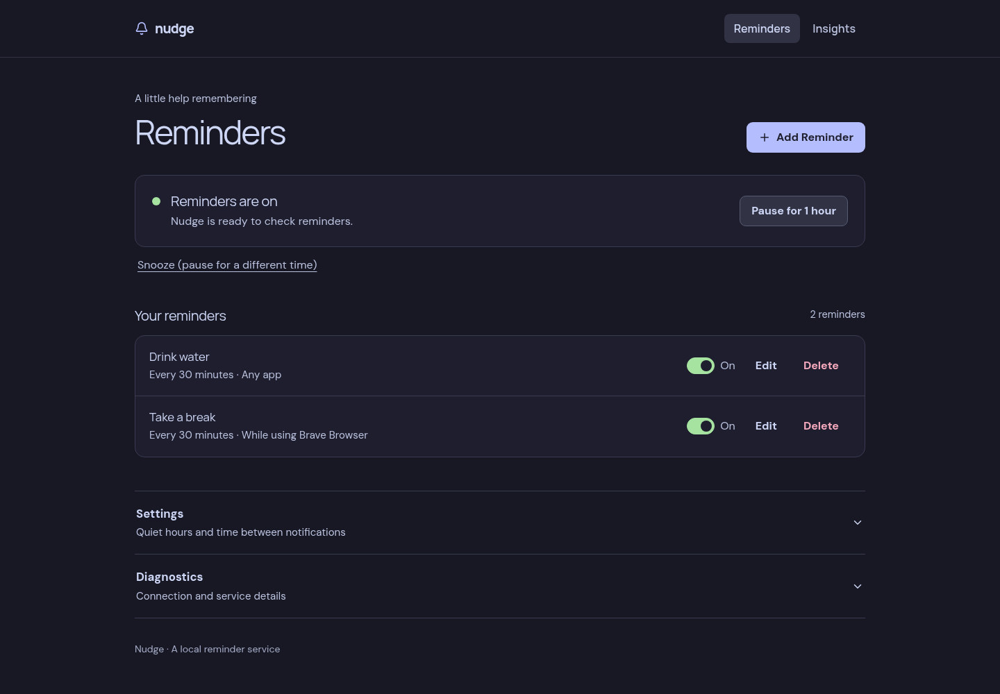

# Nudge

Nudge is a local, app-aware reminder daemon for Niri on Linux. It sends desktop notifications with `notify-send` and serves a browser dashboard.



- Schedule periodic reminders or reminders for a focused app.
- Edit rules, quiet hours and a shared cooldown in the dashboard.
- Pause or snooze reminders; scheduling continues when the browser is closed.
- Explore optional, local reminder history in Insights.

## Build and run

Build with Go 1.23+, Node.js 24+ and npm. Desktop integration needs Niri, `notify-send` and a notification service. The built executable does not need Node.js.

```sh
cd frontend
npm ci
npm run build
cd ..
go build -o nudge .
./nudge daemon
```

Open [http://127.0.0.1:8788](http://127.0.0.1:8788). The build embeds the dashboard; it must be built before the Go executable. A new installation starts with no rules.

## CLI

From the checkout after building:

```sh
./nudge every 30m "Stay focused on what matters."
./nudge watch firefox --every 15m "Be intentional."
./nudge inspect
./nudge pause 1h
./nudge resume
```

See the [usage and configuration guide](docs/usage.md) for all commands, scheduling details and troubleshooting; [user service guide](docs/service.md) for installation and migration; and [API guide](docs/api.md) for local HTTP access.

## Development

Run the daemon, then use `cd frontend && npm run dev` for the Vite development server. Its `/api` proxy targets the default daemon port. After changing frontend code, run `npm run build` in `frontend` before rebuilding Go. Checks: `npm run check`, `npm run lint` (in `frontend`) and `go test -race ./...` (at the repository root).
