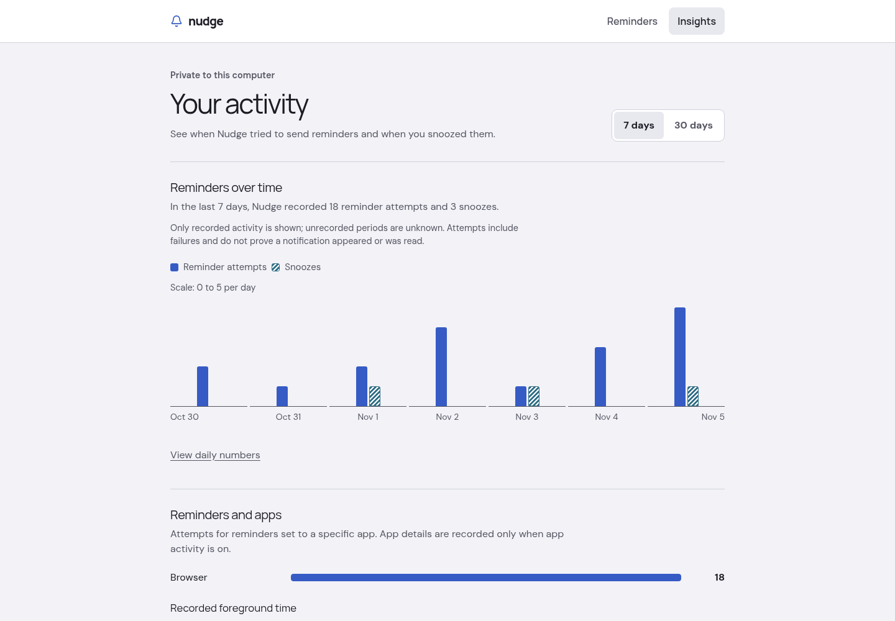

# Nudge

Nudge is a local reminder app for Linux and the Niri compositor.

## Why Nudge?

It's easy to lose track of time when using an app. Nudge can ask your desktop to show a reminder at regular intervals or while a chosen app is in focus.

## What you can do

- Create, edit, disable and delete reminders in the dashboard or add them from the CLI.
- Set quiet hours and a shared cooldown, or pause and snooze reminders. The daemon keeps scheduling when the browser is closed.
- Optionally explore local history of reminder attempts and observed app focus in Insights. History is off by default; app activity is a separate opt-in.

## Preview

**Reminders** — manage reminders and see their status.


<details>
<summary>See Insights with example activity</summary>



</details>

Both previews use example data. Nudge follows your system's light or dark appearance; reminder editing opens in a sheet on phones.

A notification attempt does not prove a notification was displayed or read. Observed window focus is not proof of active use. See [Insights and privacy](docs/usage.md#insights-and-privacy) for what is stored and its limitations.

## Build and run

You need Go 1.23+, Node.js 24+ and npm to build. Desktop integration needs Niri, `notify-send` and a notification service in your graphical session. The built executable does not need Node.js.

From the repository root:

```sh
cd frontend
npm ci
npm run build
cd ..
go build -o nudge .
./nudge daemon
```

The dashboard is embedded in the executable, so build the frontend first. Open [http://127.0.0.1:8788](http://127.0.0.1:8788) and choose **Add Reminder**, or leave the daemon running and add your first reminder from another terminal:

```sh
./nudge every 30m "Take a moment to check in."
```

A new configuration has no reminders. A new periodic reminder is initially due, subject to the shared cooldown, pause and quiet hours. For an app-specific reminder, use `./nudge inspect` to find its Niri app ID, then `./nudge watch APP_ID --every 15m "Be intentional."`.

To run Nudge as a systemd user service, follow the [installation guide](docs/service.md). It includes separate safe steps for a new or existing installation and the required graphical-session environment.

## Configuration

The dashboard and CLI share `$XDG_CONFIG_HOME/nudge/config.json` (normally `~/.config/nudge/config.json`). The default cooldown is five minutes; set quiet hours such as 22:00–07:00 under **Settings**. `NUDGE_PORT` changes the dashboard port, which remains bound to IPv4 loopback. Use the same port for `nudge web`. See the [example configuration](config.example.json) and [usage guide](docs/usage.md) for details.

Pause and resume from another terminal:

```sh
./nudge pause 1h
./nudge resume
```

## How it works and development

The Go daemon observes Niri focus events, schedules reminders and invokes `notify-send`. It serves an embedded Svelte dashboard and a loopback-only [HTTP API](docs/api.md). Optional Insights history is stored in a local SQLite database; it does not store window titles or reminder messages.

For frontend development, run the daemon and then `cd frontend && npm run dev`. The Vite `/api` proxy targets the default daemon port. After frontend changes, rebuild the frontend before rebuilding Go. Available checks are `npm run check` and `npm run lint` in `frontend`, and `go test -race ./...` at the repository root.
